# Executive Summary

The Barangay Minante 1 Integrated Management System is a browser-based application for recording and managing resident accounts, permit and certificate requests, event requests, blotter cases, appointments, walk-in assistance, payments, community programs, announcements, and operational reports. Its full project title is **Development of an Integrated Barangay Permit, Event Approval, Blotter Management System with Notification and Scheduling Features for Barangay Minante 1, Cauayan City**.

Residents submit and monitor their own transactions. Barangay Staff assist residents, verify requirements, and endorse requests. Administrators manage configuration, approve accounts and transactions, authorize signatures and financial personnel, and review system-wide reports. This division supports accountability while allowing Staff to submit personal resident transactions without processing their own requests.

The implementation uses Python, Flask, Flask-SQLAlchemy, SQLite, Jinja templates, custom HTML/CSS/JavaScript, python-docx, and matplotlib. Data persists in a SQLite file; private evidence and signature images are stored outside the public static directory. The current application produces editable DOCX acknowledgments, approved documents, payment receipts, and reports. This documentation package additionally uses ReportLab to produce its PDF; ReportLab is not an application export feature.

The documentation was prepared from the local final working tree and a read-only schema inspection, covering 35 SQLite tables, 72 declared application routes plus Flask's static route, and the available automated and browser audit evidence. {{LATEST_TEST_RESULT}} The saved browser audit covers 160 page checks. These results establish behavior within the exercised scenarios, not proof of complete security or absence of defects.

Several boundaries matter for defense and operation: SMS and email delivery are simulated; payment recording is manual cash or an Administrator waiver; signatures are electronic images rather than cryptographic signatures; appointment rescheduling changes status without editing the scheduled time; and automatic priority ordering and complete referral follow-up are not implemented. Address and ID edits restart verification in the current code. The following chapters distinguish implemented behavior, partial workflows, and future work.

# Chapter 1 — System Introduction

## 1.1 Background and problem context

Barangay transactions involve personal records, supporting evidence, decisions, dates, and communication between residents and personnel. Paper-based or disconnected recording methods can make it difficult to find previous submissions, follow a request's status, detect overlapping venue use, or prepare consolidated reports. These are the kinds of problems the developed system is designed to address. This document does not claim that an interview, survey, time study, or measured baseline established their frequency in Barangay Minante 1.

The project brings related transactions into one application. Instead of interpreting a submitted form as approval, it records separate submission, verification, endorsement, decision, payment, signature, and release stages. This distinction is central to the design: each stage has its own meaning and authorized actor.

## 1.2 Purpose of the system

The purpose is to centralize resident and service records, support traceable processing, and provide information for authorized monitoring. Core services cover permits, events, and blotters. Supporting services include schedules, in-app notifications, front-desk assistance, requirements verification, queue tracking, release recording, household membership, manual payments, Scholarship and Ayuda applications, announcements, feedback, and aggregate reports.

The software supports administrative decisions; it does not determine legal entitlement, independently authenticate an ID, automatically award assistance, or prove that a physical payment or release occurred. Personnel remain responsible for the truth of recorded actions and compliance with local procedures.

## 1.3 General objective

To develop an integrated Barangay management system that digitizes and centralizes resident service processing, monitoring, scheduling, communication records, and administrative reporting for Barangay Minante 1, Cauayan City.

## 1.4 Specific objectives

1. Provide registration, identity/address review, account approval, and role-controlled access.
2. Record permit submissions with configurable requirements and fee snapshots, supporting review through release.
3. Manage event requests and prevent overlapping reservations for the same configured venue.
4. Record complainant/respondent information and track blotter processing states.
5. Support transaction-linked appointments and in-app notifications, with clearly identified simulated email/SMS records.
6. Assist walk-in residents using the same permit workflow, with a queue ticket and acknowledgment.
7. Record authorized payments and waivers separately from configured prices.
8. Manage configurable Scholarship/Ayuda opportunities, applications, claim rules, review, and completion.
9. Publish and expire announcements according to stored dates while preserving history.
10. Generate SQLite-based analytics, editable Word reports, and activity records for authorized oversight.

## 1.5 Scope

| Area | Current scope | Boundary |
|---|---|---|
| Resident services | Registration, profile, own permits/events/blotters, schedules, notifications, program applications, documents and feedback | Approval gates access; operational records belonging to others are not resident services |
| Staff operations | Read-only user list, front desk, evidence review, endorsement, scheduling, routing and release | No general final-approval, configuration or system-report authority |
| Administration | Account decisions, catalogs, fees, signatories, final decisions, programs, announcements, reports and audit view | Actions still use route-specific validation; a configured signatory must match the acting Administrator |
| Monitoring | 17 aggregate report types, charts, filters and DOCX exports | Not a public data portal, accounting ledger, or staff-ranking system |
| Community programs | Scholarship/Ayuda drafts, publication, applications, review and completion | Human eligibility review; no automatic benefit disbursement |
| Data management | SQLite records, additive migration, private files and database backup utility | Single-service architecture; uploaded files need coordinated backup |

## 1.6 Significance

For Residents, the system provides a reference number, status visibility, evidence submission, and an assisted route for those who need help. For Staff, it organizes intake, review and front-desk records. For the Administrator, it separates final decisions from preliminary review and supplies aggregate monitoring. For Barangay management, it creates a common record base for coordination. For researchers and future developers, the source, schema, test suite, and this document provide a reproducible technical reference. Community benefit is an intended outcome; no satisfaction survey or measured service-time reduction is asserted.

## 1.7 Research and documentation boundaries

This is a source-grounded system description and technical evaluation, not a fabricated empirical research study. No survey responses, respondent counts, acceptance scores, institutional approval signatures, or external research references are invented. The document-information page leaves authorship and institutional approval to the actual project team. Current limitations and future improvements are separated in Chapter 12.

# Chapter 2 — System Overview

## 2.1 Users and role separation

**Resident:** an approved active account holder who manages personal information and submits or monitors their own transactions. A newly registered account remains Pending until the Administrator verifies its ID and address and approves it.

**Barangay Staff:** an operational user who assists residents, examines evidence, endorses transactions and handles front-desk work. Staff can make personal permit/event/blotter submissions using the same account. Backend checks prohibit Staff from processing their own requests; being assigned a request does not override that restriction.

**Administrator:** the role with broad permission grants in `permissions.py`. Administrators make final decisions, configure services, and access reports and activity logs. Additional checks still apply to particular actions: signatories must be configured, payments cannot be self-recorded, and program applications cannot be self-processed.

## 2.2 Permission matrix

The matrix combines `ROLE_PERMISSIONS` with checks inside the actual routes. A sidebar entry alone is not an authorization rule. “Own” means a record owned by the signed-in user.

| Function | Resident | Staff | Administrator |
|---|---|---|---|
| Public registration | Creates Resident account | No public Staff signup | No public Admin signup |
| Login/profile | Active approved own account | Active authorized own account | Active own account |
| View users | No | Read-only list | Manage/review |
| View uploaded valid ID | Own | Own, not others | Authorized review |
| Verify ID/address, approve registration | No | No | Pending Resident/Staff verification; Resident registration approval |
| Change role/account activity | No | No | Yes, with last-Admin safeguards |
| Create personal permits/events/blotters | Yes | Yes | Routes allow broad permissions; not normal resident role |
| View transaction records | Own | Operational access | Operational access |
| Review/endorse permits/events | No | Yes, except own | Yes |
| Final permit/event approval | No | No | Yes |
| Review permit evidence files | No dedicated owner download route | Yes, except own | Yes |
| Resubmit permit requirements | Own eligible request | Own eligible request | Not ordinary resident resubmission |
| Configure requirements/fees/venues | No | No | Yes |
| Apply electronic signature | No | No | Designated Admin for that service |
| Front desk/queue/households/concerns/referrals | No | Yes | Yes |
| Record permit release | No | Yes, except own | Yes, validated ready/signed state |
| Request appointment | Own transaction | Operational transactions | Operational transactions |
| Confirm/complete appointment | No | Yes | Yes |
| Cancel appointment | No | No | Yes, permitted states |
| Record payment | No | Only explicit payment authority, except own | Yes, except own |
| Waive fee | No | No | Yes, reason required |
| Download payment receipt | Own Paid record | Own or payment-authorized access | Yes, Paid record |
| Draft programs/announcements | No | Yes | Yes |
| Publish/close program; approve announcement | No | No | Yes |
| Program application | Own approved profile | Assisted approved Resident/Staff | Assisted approved Resident/Staff |
| Program review/qualification | No | Yes, except own | Yes, except own |
| Approve/waitlist/complete program application | No | No | Yes, except own |
| Read/mark notifications | Own | Own | Own |
| Send notification | No | Yes | Yes |
| Reports/charts/Word report export | No | No | Yes |
| Activity Logs/configuration | No | No | Yes |
| Feedback | Own completed permit, once | Own completed permit, once | Route requires ownership |

## 2.3 Module map and implementation classification

| Module | Classification | What is present |
|---|---|---|
| User/account management | Implemented with correction limits | Registration, verification, approval, roles, profile, reset-token logic |
| Permit processing | Implemented | Snapshots, review, endorsement, decision, payment gate, signature and release |
| Event approval | Implemented | Configured category/venue, conflict prevention and temporary recommendations |
| Blotter management | Partially Implemented | Intake and status progression; stored resolution/officer fields lack a complete editing workflow |
| Scheduling | Partially Implemented | Linked requests and status changes; no appointment time-edit or officer/office assignment workflow |
| Notifications | Partially Implemented | In-app read state works; email/SMS delivery simulated |
| Front desk and queue | Implemented with limits | Assisted permits, ticket state progression and acknowledgment; no automated priority ordering |
| Payments | Implemented within manual scope | Exact cash amount, Admin waiver, receipt and authorization |
| Community programs | Implemented | Scholarship/Ayuda configuration, claims, review, capacity and completion |
| Announcements | Implemented | Draft approval, time-filtered publication/expiry and archival |
| Reports/activity logging | Implemented | SQL aggregates, DOCX, action records and admin view |
| Concerns/referrals | Partially Implemented | Concern intake/routing; referral intake; no full resolution/distribution lifecycle |
| Household management | Partially Implemented | Create, head/member association, transfer and statistics; no dedicated move-out operation |
| Profile update requests | Partially Implemented | Staff-assisted change proposal and Admin decision; direct profile edits coexist |

## 2.4 Input–Process–Output model

**Simple explanation.** Inputs are the information and evidence people provide. Processing validates and reviews that information. Outputs are the stored decisions and documents users receive.

**Technical explanation.** Forms carry a session CSRF token to Flask. Routes validate ownership, permission, fields and workflow state. SQLAlchemy writes related records in a transaction. Jinja pages, notifications, editable documents and aggregates expose the resulting state to authorized users.

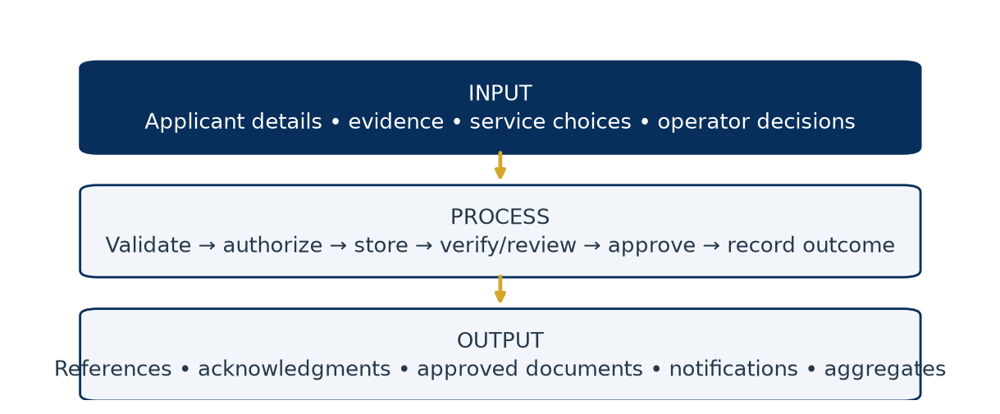

The figure separates applicant evidence from staff decisions and resulting documents. An acknowledgment is an output of intake, not a decision of approval.

## 2.5 Data flow diagram

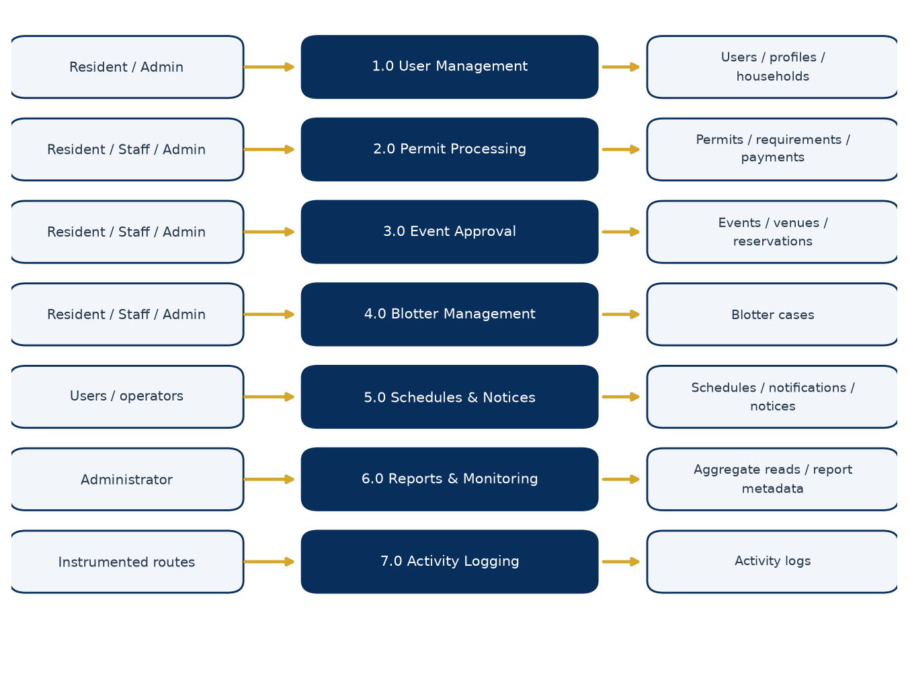

This logical DFD groups implemented responsibilities, not separate deployed servers. Process 1.0 manages users/profiles/households; 2.0 manages permits/requirements/signatures/payments; 3.0 manages events/reservations; 4.0 stores blotter cases; 5.0 handles schedules/notifications and announcement visibility; 6.0 reads aggregate data and exports reports; 7.0 records and displays audit actions. Programs extend resident services and monitoring using separate program/application tables. Front-desk intake feeds the same permit records as online requests. A payment receipt is derived from a real Payment row, not the permit-type fee catalog.

# Chapter 3 — Architecture and Technology

## 3.1 Architecture and layers

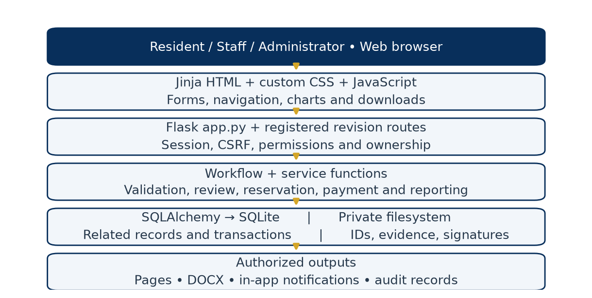

**Simple explanation.** The browser displays forms; Flask checks what a person may do; the database remembers the transaction; document and chart services turn authorized records into useful output.

**Technical explanation.** This is a server-rendered Flask monolith, not a microservice or single-page-application architecture. `app.py` owns the Flask instance and most routes. `register_revision_routes()` attaches payment/program routes directly to that instance. There are no Flask Blueprints in the inspected implementation.

| Layer | Actual files/components | Responsibility and data movement |
|---|---|---|
| User/browser | Browser forms and downloads | Sends HTTP requests and renders responses; does not authorize itself |
| Presentation | `templates/*.html`, `static/css/style.css`, `static/js/charts.js` | Jinja-generated pages, custom styling, form helpers and Canvas charts |
| Request/security | `app.py`, `permissions.py` | Session lookup, CSRF, authentication, permission and ownership checks |
| Workflow/service | `workflows.py`, `revision_routes.py`, `services/` | Status rules, snapshots, payments, reservations, publication, reporting and documents |
| Persistence | `models.py`, Flask-SQLAlchemy, SQLite | Mapped records, transactions, relationships, indexes and constraints |
| Private file storage | Configured data-directory subfolders | Evidence, IDs and signature images; only protected routes expose selected files |
| Output/monitoring | DOCX generators, notifications, activity logs | Records or returns the authorized result; SMS/email currently simulated |
| Operations | `config.py`, `migration.py`, `seed.py`, `backup_sqlite.py` | Configuration, upgrade, initial catalogs/Admin, consistent database backup |

## 3.2 Technologies actually used

| Technology | Category | Purpose |
|---|---|---|
| Python | Programming language | Flask handlers, validation, models, services and maintenance utilities |
| JavaScript | Programming language | Form interaction, busy state, navigation, previews and Canvas charts |
| HTML / Jinja | Markup / templating | Server-rendered page structure and escaped content |
| CSS | Styling | Custom Navy and Civic Gold interface and responsive layout |
| SQL | Query language | Generated SQLAlchemy queries, SQLite pragmas and migration statements |
| SQLite / Python sqlite3 | Embedded database / standard library driver | Persistent local relational data and backup API |
| Flask 3.1.3 | Web framework | Routing, request/response handling and signed sessions |
| Flask-SQLAlchemy 3.1.1 / SQLAlchemy | ORM integration / library | Models, relationships, query construction and transactions |
| Werkzeug 3.1.8 | Web/security utility | Password hashing/checking and Flask infrastructure |
| python-dotenv 1.1.1 | Configuration library | Optional `.env` loading |
| python-docx 1.2.0 | Document library | Editable application DOCX output and this documentation's Word file |
| matplotlib 3.11.2 | Plotting library | Server-side chart PNGs for dashboards/reports and document figures |
| Gunicorn 26.2.0 | Deployment server | Configured Linux/Render WSGI deployment |
| unittest / Playwright with Edge | QA tools | Automated acceptance tests and browser audit; Playwright is a development tool |
| ReportLab / pypdf | Documentation-only tools | Build and structurally validate this PDF; not application runtime features |

There is no Flask-Login implementation: authentication is custom session-based code. Chart.js and Bootstrap are not used; charts use custom Canvas JavaScript and matplotlib, and layout uses project CSS. MariaDB/MySQL references in old material are legacy; `Config` rejects a non-SQLite `DATABASE_URL`.

## 3.3 Real project structure

```text
My-projects--main/
  setup.ps1, run.ps1, render.yaml, RENDER_DEPLOYMENT.md
  SYSTEM_AUDIT_REPORT.md
  SYSTEM_RESEARCH_DOCUMENTATION.md       (historical)
  documentation/
    CAPSTONE_DOCUMENTATION.md            (current narrative source)
    collect_evidence.py, build_documentation.py
    source_evidence.json, assets/
  barangay_system/
    app.py, revision_routes.py
    models.py, permissions.py, workflows.py
    config.py, migration.py, seed.py, backup_sqlite.py
    requirements.txt, README.md
    services/
      analytics.py, documentgen.py, event_availability.py
      notify.py, revision.py, uploads.py
    templates/                           (Jinja pages and partials)
    static/css/style.css
    static/js/charts.js
    tests/                               (acceptance and audit utilities)
    instance/                            (private runtime data; ignored)
    audit-artifacts/                     (generated test evidence; ignored)
```

The `instance` directory contains the configured database and private data by default. It must not be distributed as sample project content. The documentation evidence manifest contains schema/source metadata only, not resident records or file contents from private storage.

## 3.4 Frontend behavior

`base.html` provides the authenticated shell, sidebar, header, notifications indicator and shared behavior. `auth_base.html` supports authentication pages. Page templates reuse cards, form rows, tables and status labels. Navy (`#082F5B`) emphasizes structure and Civic Gold (`#D4A62A`) marks highlights. CSS media rules and a mobile navigation toggle adapt the layout; tables may use scrolling containers.

Forms include CSRF tokens and browser-required controls, with backend validation remaining authoritative. Submission controls indicate a busy state and block repeated submission; restoration/timeouts recover controls. Feedback appears through flash/toast patterns. The code does not implement a uniform AJAX-based, section-local verification response for every ID/address/account action: those actions use redirects and flashes. Requirement notes remain associated with their requirement record, but uninterrupted inline review must not be promised.

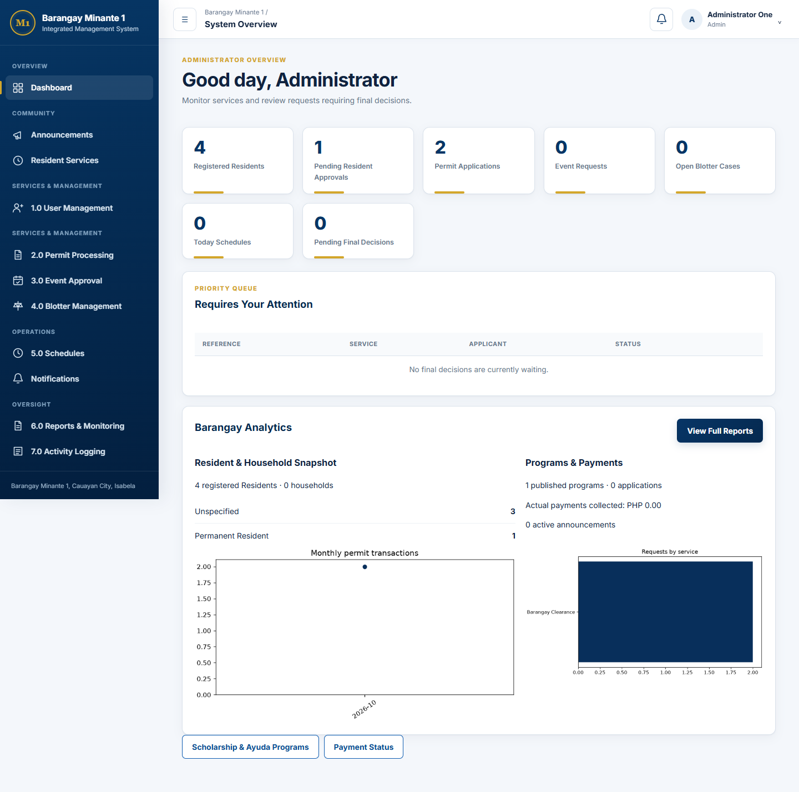

This is an actual rendered interface using test fixtures, not production resident data. Displayed counts illustrate the audit fixture only; they are not population or performance statistics for Barangay Minante 1.

# Chapter 4 — Complete Feature and Functionality Documentation

## 4.1 Registration, account management and verification

**What / why / who.** Registration records an applicant's identity, residence and contact details so the Administrator can review access before service use. Public registration creates a Resident role; Administrator-controlled user management handles operational accounts.

**Simple explanation.** A person signs up, provides an accepted ID and address details, and waits for review. Submitting a registration does not immediately authorize login.

**Technical explanation / how.** `register()` validates personal/account fields, email/phone format, birth/residency values, password confirmation, required ID upload and privacy consent. `User` and `ResidentProfile` are saved together. New profiles have Pending approval and Pending Verification for ID/address. ID types must be active and accepted for registration. Optional “Others” selections require explanation. The registration sections include name, birth date, sex, civil status, occupation, house/street, Purok/zone, resident type, residency status, residency years, household information, emergency contact, username, email and password.

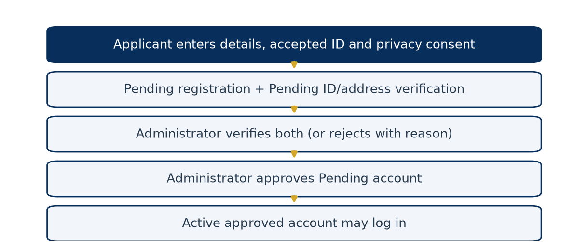

`user_verification()` handles ID/address decisions and permits a decision only while its status is Pending Verification. A rejection requires a reason. `user_approval()` approves only a Pending registration after both verifications are Verified; repeat finalized decisions return a warning. `resident_identification_document()` allows the owner or Administrator, and uses a private directory. Image IDs can be previewed; PDFs are served as documents. Verification metadata includes actor, time and correction reason; `activity_logs` preserves important actions.

**Security / output / limitations.** A profile stores an ID file path and number; it does not validate the document against a government service. Changes to ID type/number/file through an authorized profile session reset ID review to Pending Verification. Pending/rejected applicants cannot use ordinary authenticated profile pages, so a complete pre-approval self-service correction loop is not present. The office must handle such cases; the documentation does not invent a correction route. ID/address/account decisions condition their database update on the expected Pending state. A stale competing action cannot change a finalized state through that update; review metadata and logs are written only after it succeeds.

## 4.2 Resident Type versus Residency Status

Resident Type describes the person's housing relationship; the Administrator-managed catalog is distinct from current Residency Status. The seeded types include Homeowner, Renter/Tenant, Household Member, Boarder/Bedspacer, Caretaker, Temporary Resident and Others. Residency Status records Permanent Resident, Temporary Resident, or Former Resident / Moved Out. A renter can be a permanent resident; therefore the two concepts should not be merged. `resident_profiles.resident_type_id` references the catalog while `residency_status` stores the current selected state.

Address review uses street/address, Purok/zone, residence category/status, years and household details displayed in account review. It records an administrative verification, not geolocation or proof generated by the software. Changes to street/Purok in `profile()` and approved address/Purok update requests reset `address_verification_status` to Pending Verification and clear previous reviewer/time/reason. This requests a fresh human decision; it does not automatically verify the new address. Changes to household text or residency category alone are not included in the same reset comparison. A complete pre-approval rejected-address correction portal remains absent.

## 4.3 Login, password recovery and profile

**Simple explanation.** Authentication identifies the account; authorization decides which actions that account may perform.

**Technical explanation.** `login()` looks up credentials, checks the Werkzeug password hash, checks activity and approval, records the session, then redirects to the role dashboard. `load_user_and_csrf()` loads the session user into `g.user`; `login_required()` rechecks role/activity/approval on protected requests. The browser receives a signed Flask session cookie, not a database password. Password validation requires at least ten characters with a letter and a digit. Profile password change additionally checks the current password.

`PasswordResetToken.issue()` creates a random token and stores its SHA-256 digest, expiry and consumption state. `valid_for()` checks the digest, unused state and expiry. Reset completion changes the password and marks outstanding tokens used. The default lifetime is 30 minutes. Recovery email is simulated; in debug mode a development reset link can be shown. This is not a working production email recovery delivery service. Sequential reuse is tested; do not describe all concurrent reset requests as atomically single-use.

`profile()` saves validated changes directly for an authorized logged-in user. This coexists with the Staff-assisted update-request approval feature; not all profile edits are routed through an approval queue. ID type/number/file changes restart ID verification; street/Purok changes restart address verification. These resets do not themselves change an already Approved account back to Pending approval.

## 4.4 Permit processing and dynamic requirements

**What / why / who.** Permits and certificates are configurable services requested by Residents or personally by Staff, reviewed by non-owner personnel, and finally decided by Administrators. Dynamic requirements allow service-specific evidence without hardcoding a separate form per certificate.

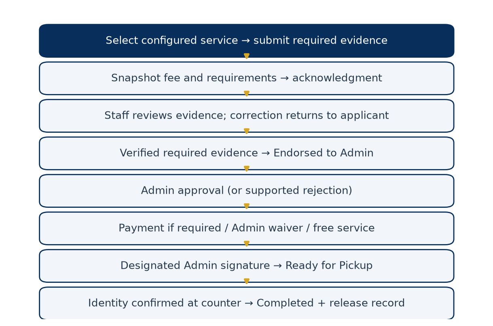

**Technical explanation / how.** `permits()` loads active permit types. A fee must be explicitly configured, including zero for a free service. Submission creates `permit_applications` and calls `create_requirement_snapshot()`. Each current definition becomes an `application_requirements` row with copied name, type, instructions and required flag, plus submitted text/file and state. `requirement_history` records evidence/review events. Required evidence is validated before commit; staged files are cleaned if the transaction rolls back.

Requirement types are Document (private PDF/PNG/JPEG), Text (typed value), or System Check. The implemented System Check tests the Resident profile's Approved account state; it is not a configurable external eligibility engine. Optional omissions are Not Submitted. Submitted items enter Submitted; review may move to Under Review, Verified or Needs Resubmission according to route validation. A correction requires a note, such as “Image is blurry; please upload a clearer copy.” The owner can replace evidence only when the workflow allows resubmission. A finalized Verified item is not simply reverified on repeat requests.

`requirement_progress()` counts submission/verification states for the progress display. Endorsement requires all required items to be Verified; optional omissions do not block it. `update_status()` validates the role-aware transition map. The main permit states are Pending, Under Review, Endorsed to Admin, Approved, Ready for Pickup and Completed, with supported Rejected/Cancelled branches. Generic state updates cannot bypass payment/signature/release routes.

**Database / security / output.** Definitions remain in `service_requirements`; the application copies preserve historical requirements even when future definitions change. `fee_at_submission` preserves the price at submission. `permit_processor_allowed()` prevents Staff processing their own permit. Owners can view their request and resubmit, but the current private requirement-download handler is for processing personnel, not a general owner evidence-download endpoint. A submission acknowledgment confirms intake; the official document becomes available only after approval, applicable payment and signature.

## 4.5 Pricing, electronic signature and approved document

The Administrator configures a non-negative service fee and readiness flag. A zero fee means Not Required for payment; a missing/unconfigured fee blocks new submission. Fee changes affect future submissions, not the stored `fee_at_submission` on existing records. A configured fee is not an actual collection.

`PermitSignatory` links a permit type to an authorized Administrator and private PNG/JPEG signature asset, with signatory name/title. `sign_approved_permit()` checks Approved status, verified required evidence, payment eligibility, correct Administrator and an existing signature image. It records signer/time, copied signatory details and document version, then sets Ready for Pickup. `generate_approved_permit_document()` builds native Word text/tables and includes the image when available. This is an electronic signature image with recorded authorization, not a certificate-based cryptographic digital signature or independently verifiable tamper seal. Editing the downloaded DOCX is technically possible.

## 4.6 Event approval and reservation conflict logic

**What / why / who.** Residents and Staff submit event requests for configured categories and venues. Personnel review and endorse; Administrators decide. Reservation checks coordinate competing requests for the same place and time.

**Actual inputs.** Event name, category, venue, description, proposed date, start time and end time. The category fee is snapshotted. Expected attendees and supporting attachment remain legacy database columns but are not current event form inputs.

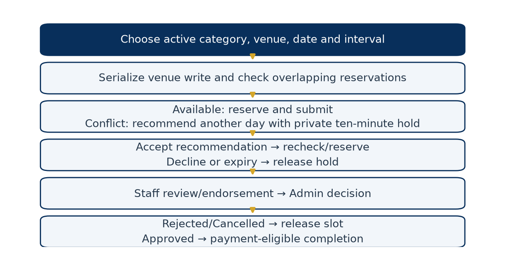

**Technical explanation.** `_parse_event_form()` validates the active category/venue, configured fee and interval. `event_availability.py` serializes venue reservation writes using a venue update before conflict checks. `find_conflict()` compares intervals using start-before-other-end and end-after-other-start. Thus 09:00–10:00 and 09:30–10:30 overlap, while 09:00–10:00 and 10:00–11:00 are adjacent. Priority belongs to the transaction that successfully reserves the slot, not necessarily the first browser page opened.

`find_next_available()` searches alternative days with the requested time interval, up to 365 days; it does not search every free minute. `create_hold()` reserves a recommendation temporarily for ten minutes with an owner-bound hashed token and serialized draft. `accept_hold()` creates/links the real request after another conflict check. Decline, expiry, rejection or supported cancellation releases the reservation. Another applicant sees availability results, not the other person's event details. The current transition map allows cancellation only in its configured early state; no general Resident cancellation route is implied.

**Output / limits.** A successful submission produces a reference and acknowledgment; changes trigger notifications. Paid events need payment eligibility before completion. Event input is parsed as a naive datetime and compared with naive UTC helpers, unlike explicit Manila conversion for program/announcement inputs. Timezone treatment is therefore inconsistent and needs reconciliation before relying on all local-time boundaries.

## 4.7 Blotter management

**What / why / who.** A blotter records a complaint involving an identified respondent and incident. It differs from a general service concern such as a streetlight or drainage issue. Owners can file/view their own cases; Staff/Admin have operational access.

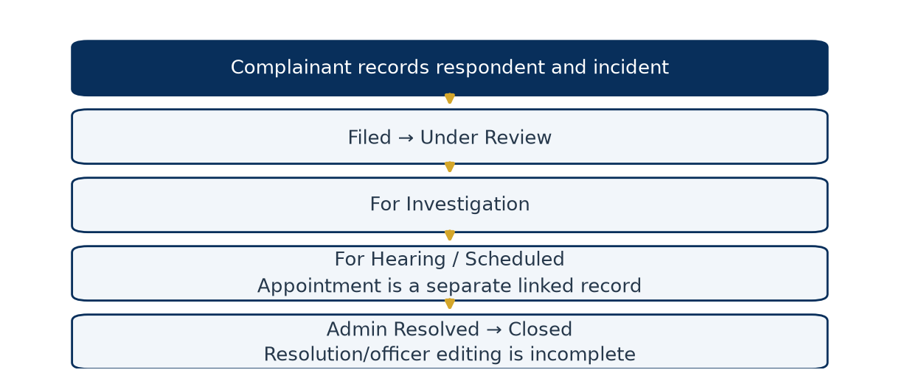

`blotters()` records complainant account, respondent name/address, incident type/date/location, narrative and optional evidence. `blotter_detail()` applies the role transition map: Filed, Under Review, For Investigation, For Hearing / Scheduled, Resolved, then Closed where authorized. The `blotter_cases` table also contains `assigned_officer`, `hearing_date` and `resolution`, but the current detail POST delegates to generic status changes and does not provide a full editing workflow for these fields. A separate Schedule can reference the case, but setting the case to For Hearing / Scheduled does not itself create that appointment.

Private narratives are excluded from aggregate reports. The actual protection is role/ownership control, not a special investigator-assignment permission model. Resolution is a recorded processing state, not an automated legal determination.

## 4.8 Walk-in assistance, search and acknowledgments

**What / why / who.** Staff/Admin can assist residents who lack a device, connection or confidence using the system. The encoder and requester are different roles in the record.

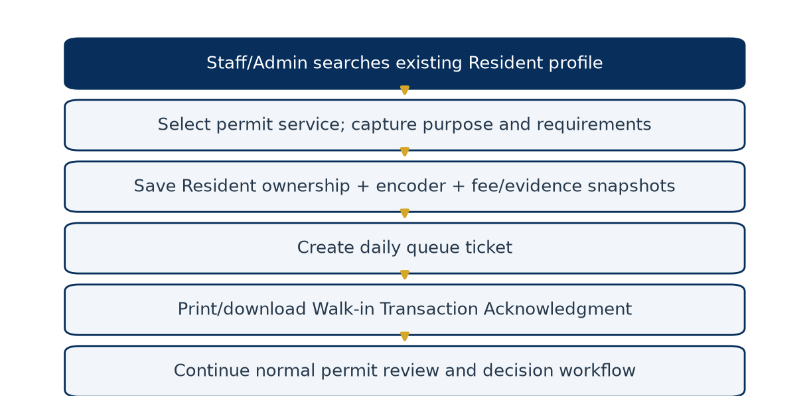

`search_residents()` searches name, username, numeric User ID, contact number, profile household number and Purok/zone; it returns at most 50 results. The quick selection card shows name, username and location/household summary, not a separate comprehensive profile application. Operational users select the resident, active permit service, purpose, optional counter and required evidence. `front_desk()` stores source “Walk-in / Staff Assisted,” the Resident as `applicant_id`, and Staff/Admin as encoder. It snapshots requirements and creates a daily Document Request ticket in the same transaction.

The current front-desk resident eligibility helper requires a resident/staff account with a profile, but does not independently enforce active/Approved account status. A required System Check may reject an unapproved profile. Consequently the search's “approved” empty-state wording is stronger than the actual helper filter. This is a documented implementation gap, not an assurance of approved-only assisted submissions.

`walkin_acknowledgment()` provides the print view. The legacy-named `claim-stub.docx` route now returns a Walk-in Transaction Acknowledgment containing request/claim reference, resident, service, submission time, queue, requirements, fee/payment state, encoder, next steps and disclaimer. It does not approve the service or prove cash collection.

| Document | Trigger | Meaning |
|---|---|---|
| Submission Acknowledgment | Successful online request/program submission | Intake was recorded |
| Walk-in Transaction Acknowledgment | Assisted request; queue included for permit walk-ins | Office recorded an assisted transaction |
| Payment Receipt | Actual positive Paid row | Authorized personnel recorded payment |
| Approved Permit/Certificate | Approved, payment-eligible and signed request | Official generated service document in the implemented workflow |

Assisted program applications use an assisted acknowledgment but do not create a permit queue ticket. Full staff-assisted Event/Blotter encoder forms are not part of the dedicated walk-in permit form.

## 4.9 Queue, priority and release counter

Queue numbers use a category prefix and six-digit daily sequence; Document Request uses A, Complaint / Concern uses B, and the helper defaults to C for other categories. The current intake route creates Document Request tickets. A database unique constraint on `(queue_date, queue_number)` prevents duplicate daily identifiers. Queue creation is exercised by a two-request concurrency test; no claim is made for unlimited workload.

`update_queue()` implements Waiting → Now Serving → Serving → Completed. An update conditioned on the previous status rejects competing stale transitions. The display is ordered by creation time. Although `priority_category` exists, there is no active assignment/ranking engine for Senior Citizen, PWD, pregnancy or other categories. Personnel must follow Barangay policy manually; the documentation does not imply priority automation.

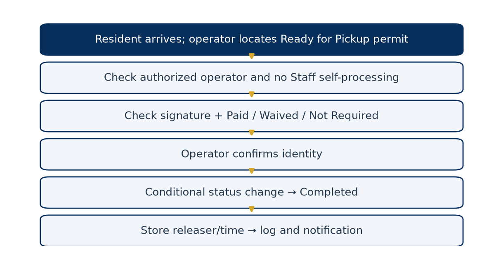

At release, Staff/Admin locate a Ready for Pickup permit, confirm identity, and submit the release action. `release_walkin_permit()` checks payment eligibility and signing, prevents Staff self-processing, and conditionally changes Ready for Pickup to Completed. It stores `released_by`/`released_at`, logs the action and notifies the owner. This route also supports ready online permits displayed at the counter. The identity confirmation is an operator checkbox, not biometric or live-ID validation. A second release attempt cannot repeat the eligible status update.

## 4.10 Appointments and assignment

`schedules()` creates a Requested appointment tied to an existing permit/event/blotter and its actual owner. Residents can choose only their own transactions; operational personnel can select operational records. Staff can Confirm, mark Rescheduled and Complete permitted states; Admin can additionally Cancel. Notifications record status changes. The schedule model has no separate office or officer-assignment fields; `confirmed_by` records who changed status, not an assigned officer.

**Partial implementation:** `schedule_status()` updates status but does not accept a replacement `scheduled_datetime`. Selecting Rescheduled therefore does not change the time. Do not instruct users to perform a nonexistent date-edit action.

Permit routing is separate: `assign_permit()` validates an active Staff/Admin assignee other than the requester, marks earlier assignments Reassigned, and creates an Active `request_assignments` row with actor/note. The permit's optional `office_name` is intake text, not a normalized office-routing system. Assignment history is stored; it does not grant permission or restrict all other operational users from seeing the request.

## 4.11 Payment management

**Simple explanation.** Pricing says what should be paid; a Payment row records what authorized personnel say was actually received or waived.

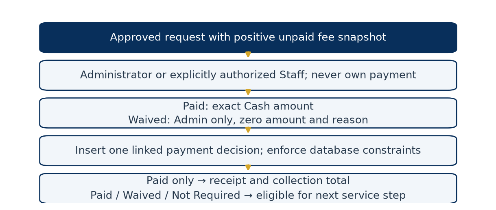

`payments()` accepts manual decisions for approved unpaid permits/events. Administrators can grant/revoke Staff financial authority in `payment_authorities`. Ordinary Staff see their own payment records; authorized personnel can handle operational payments. No actor may record their own payment. Paid requires the exact positive fee snapshot and Cash method. Waived requires Administrator role, a reason and zero paid amount. There is no partial payment, refund, online gateway, bank reconciliation or extra-charge workflow.

`payments` links exactly one permit or event; unique request keys prevent another payment decision for the same request. Database checks allow only Paid/Waived with the correct amount relationship. `payment_status()` returns Not Required for a zero fee, otherwise Paid/Waived from the linked record or Unpaid. Only positive Paid records produce receipts or collection totals. A waiver is not a receipt. No application route edits historical payment decisions. Personnel with direct database access are outside that UI restriction; the ledger is not cryptographically immutable.

## 4.12 General concerns, referrals and resident updates

General concern intake supports free-text categories such as streetlight, waste, noise, drainage, road or stray-animal issues. These are examples, not a hardcoded official category catalog. `create_general_concern()` stores resident, description, location and Standard/Restricted marker. `route_general_concern()` assigns an active Staff/Admin and sets Routed. There is no full resolution/closure form. “Restricted” is a stored label; the front-desk role gate does not implement additional per-category clearance within Staff/Admin access.

`create_assistance_referral()` records a resident, category, description and sensitivity marker, with Open default status. Although an assignment column exists, there is no implemented end-to-end referral dispatch, assigned-personnel update, external agency response or closure route. It is intake, not emergency response or assistance delivery.

`create_resident_update_request()` is Staff/Admin assisted: it records old/proposed contact, email, address, household number or Purok values. Administrator `review_resident_update()` accepts Approved/Rejected only for Pending requests using a conditional update and validates email/phone for approval as applicable. Approved values update the target profile/User field. There is no Resident-facing update-request submission route; residents can still directly edit allowed fields through Profile. Household-number edits do not automatically modify household membership records. Approved address/Purok edits restart address verification.

## 4.13 Household management

`households` stores unique household number, address, head and status; `household_members` links resident accounts with membership state and join/leave times. Staff/Admin `manage_household()` creates/finds a household, adds/reactivates membership, marks other active memberships Transferred, clears a transferred head and optionally sets the new head. It serializes changes before reading memberships and updates the resident profile's household-number text.

Actual membership rows, rather than profile text alone, determine Per Household program eligibility. One active membership is required. Household statistics aggregate stored rows. No dedicated move-out action is exposed; selecting Former Resident / Moved Out in a profile is not an automated membership termination. User-facing household text/head flags and normalized membership data can diverge through other edit paths, so operational reconciliation remains necessary.

## 4.14 Scholarship and Ayuda programs

**What / why / who.** Both program types use the same configurable engine. Staff/Admin create drafts; Admin approves/publishes/closes and makes final application decisions. Approved Residents can apply, and Staff/Admin can encode on behalf of an eligible Resident/Staff account.

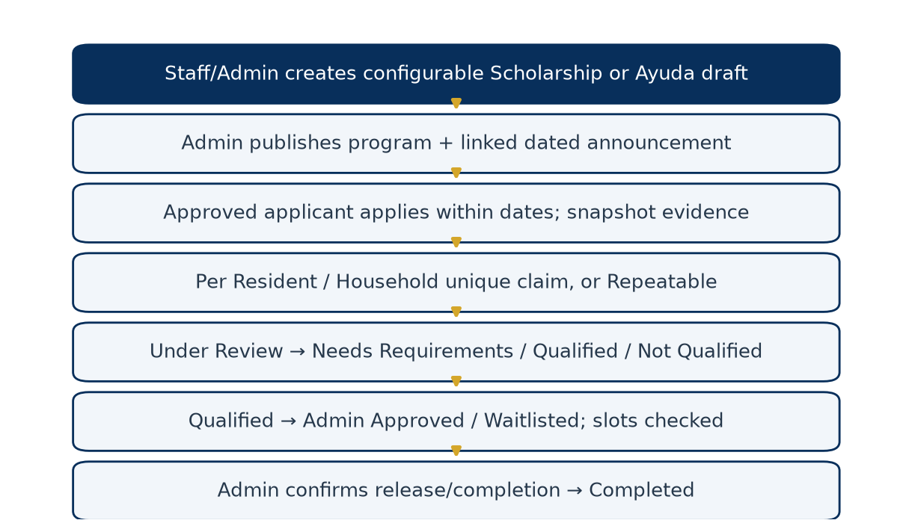

Program configuration includes type, title, description, provider, assistance type, eligibility text, target categories, instructions, requirements, application start/deadline, optional distribution date/slots, application enablement and claim rule. The rule can be Per Resident, Per Household or Repeatable. Eligibility is reviewed manually; text criteria are not executable rules. Requirements use Document/Text/System Check validation, stored as JSON definitions and per-application snapshots.

Publication changes Draft to Published and creates a linked scheduled/active announcement with expiry at the application deadline. Resident visibility respects start time. Application submission requires Published status, enabled applications, an approved active applicant, and start ≤ now < deadline. Per Resident/Household creates a non-null claim key protected by `(program_id, claim_key)` uniqueness. Even a rejected application occupies the one-time claim key; no automatic reapplication exception is implemented. Repeatable uses a null key and allows repeated applications.

Application states are Submitted → Under Review → Needs Requirements/Qualified/Not Qualified. A Needs Requirements application can be resubmitted. Qualified can become Approved or Waitlisted; Waitlisted can become Approved; Approved can become Completed. Negative/correction review requires a note. Qualification requires explicit evidence/eligibility confirmation. Admin-only approval checks slot capacity under a SQLite writer lock, counting Approved and Completed allocations. Completion requires explicit release confirmation and records releaser/time. Neither Staff nor Admin may process their own application.

`program_application_history` stores the prior evidence snapshot and resulting status/note for changes. Owners and authorized operators access private documents; program reports expose aggregates rather than applicant evidence. Ayuda completion records assistance release; Scholarship completion records fulfillment. Neither transfers money nor confirms receipt through an external agency. Closing a program archives linked announcements; application deadline enforcement does not automatically set the program's status to Closed.

## 4.15 Announcements and timed visibility

`announcements()` accepts title, body, category and required start/expiry timestamps. Staff submissions remain Draft; Admin creation can be approved immediately. Admin approves a still-valid draft to Scheduled/Published and can Archive via the compatibility `/delete` route, which preserves the row.

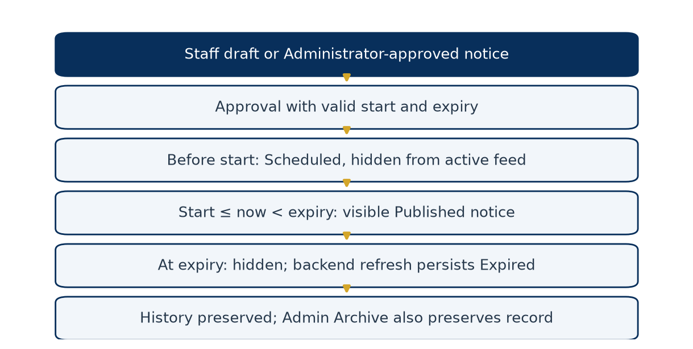

`local_datetime()` interprets naive announcement/program input as Asia/Manila and stores naive UTC. `active_announcements()` always applies start/expiry boundaries to the feed. `refresh_announcements()` persists Published/Expired changes and audit actions when relevant backend pages are accessed, with conditional updates for competing refreshes. No scheduler runs in the background, so persisted status/audit time may lag until the next access; visibility remains bounded by query time. Legacy announcements without an expiry retain prior behavior. Expired/Archived rows remain available in Administrator history. Linked Scholarship/Ayuda announcements lead to the program record.

## 4.16 Notifications, activity logs and feedback

`create_notification()` creates in_app, email or sms rows. In-app rows are marked sent and have read/unread state. Email/SMS with contact details are marked simulated; missing contact can produce failed. No provider API is called even if a provider-like environment value is set. Workflow helpers queue notifications with the same database transaction where applicable. `notification_read()` and `notifications_read_all()` update the current recipient's state. Operational send forms are available to Staff/Admin.

`audit()` calls `log_activity(commit=False)` to record actor, role, action, resource, reference, details, IP, user agent and UTC timestamp. Calling routes normally commit business changes and logs together. Login, account review, requirement review, payment, release, program changes, announcements and report actions have explicit log calls. Activity Logs is Admin-only, with no normal delete route. It is not a universal database change-capture service: actions without an explicit log call, such as current feedback creation, should not be described as independently audited. Logs are not cryptographically tamper-evident.

`submit_permit_feedback()` accepts a 1–5 rating and optional comment from the owner of a Completed permit. A `(resident_id, permit_application_id)` unique constraint blocks duplicates. The Administrator report shows counts and average rating. No survey-based satisfaction result is inferred from this facility.

## 4.17 Role dashboards and monitoring

**Administrator Dashboard.** `dashboard()` counts resident profiles, Pending resident approvals, permits, events, open blotters, today's appointments and endorsed requests awaiting final decisions. `dashboard_analytics()` adds household/program/application totals, actual Paid collections and active announcements. “Registered Residents” is a profile count, which can include Staff with resident profiles. The actionable tables filter endorsed requests before taking the latest six, so unrelated completed records do not hide older pending decisions.

**Staff Dashboard.** Counters cover other applicants' Pending/Under Review/endorsed permits and events, new blotters, today's appointments, personal requests, ready documents, requirements needing correction, unresolved concerns and today's assisted permits. Review tables exclude Staff-owned permit/event requests. Personal requests remain separately accessible. A counter is a count of stored records, not a ranking of employee performance.

**Resident Dashboard.** Queries are scoped to the current owner's permits, events, blotters and schedules. Cards show active applications, blotter count, upcoming appointments and unread in-app notifications. The latest implementation excludes past and Cancelled appointments from the upcoming list using Manila wall time and the allowed appointment states. Recent personal requests and notifications provide navigation to their detail pages.

**Code / data / controls.** The route reads the relevant models and supplies `dashboard.html`; it does not maintain a second dashboard database. Full analytics are passed only for the Administrator. The stabilization tests cover older actionable work remaining visible and Resident appointment filtering. The historical screenshot in Figure 4 uses synthetic records and may show fewer entries than a live installation.

# Chapter 5 — SQLite Database Documentation

## 5.1 Database purpose and connection

**Simple explanation.** SQLite is the application's digital filing cabinet. It stores related records in a persistent file so closing a browser or restarting the process does not erase them when the file is on persistent storage.

**Technical explanation.** `Config.SQLALCHEMY_DATABASE_URI` uses a SQLite connection string. By default the database is `barangay_system/instance/minante.db`; `DATA_DIR` or `SQLITE_DB_PATH` can change this location. Flask-SQLAlchemy attaches a session to Flask and maps classes in `models.py` to tables. SQLAlchemy sends SQL through Python's sqlite3 driver. SQLite was selected in the current configuration for a small, single-service deployment with no separate database server. This is an architectural fit, not evidence of a formal comparison study.

The connection hook enables foreign keys, a 30-second busy timeout, WAL journaling and NORMAL synchronous mode. WAL helps readers coexist with a writer; it does not enable unlimited parallel writers. `check_same_thread=False` permits connection use managed by the application stack; it does not make arbitrary shared-session access safe. ORM sessions must remain request/thread scoped.

## 5.2 Primary keys, foreign keys and relationships

A primary key uniquely identifies a row: `users.id` identifies an account. A foreign key links records: `permit_applications.applicant_id` points to `users.id`. Usernames and public references are business identifiers protected by unique constraints; they do not replace all internal numeric keys.

One User can have many permits, events and blotters, but at most one ResidentProfile because `resident_profiles.user_id` is unique. One permit has many snapshotted requirements; each requirement has history. A payment links one permit or one event, never both. A program has many applications and each application has history. A household has many membership rows. Repeated actor references (creator, reviewer, releaser) point back to Users and have distinct meanings.

`schedules.related_type/related_id` and notification related references are polymorphic logical links validated in routes; they are not direct foreign keys to three different transaction tables. `resident_profiles.household_number` is text, not a foreign key to `households`; operational membership is represented by `household_members`. Valid ID data lives in ResidentProfile plus private files, not a separate invented Identification table.

## 5.3 Simplified entity relationship diagrams

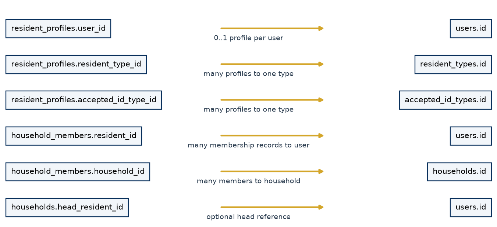

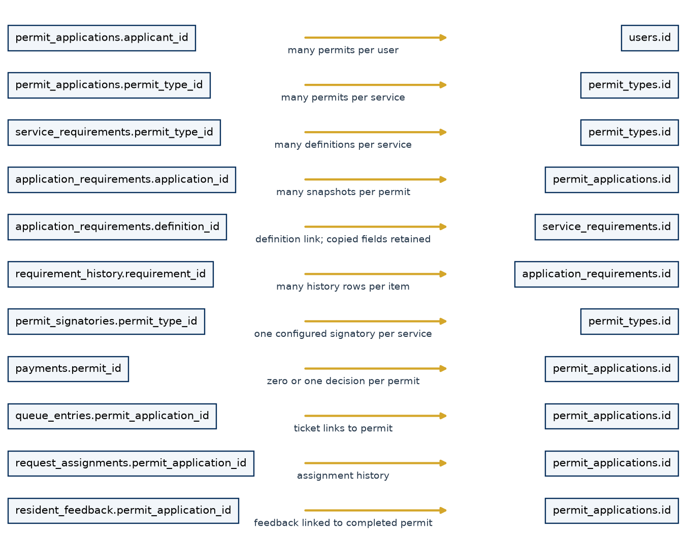

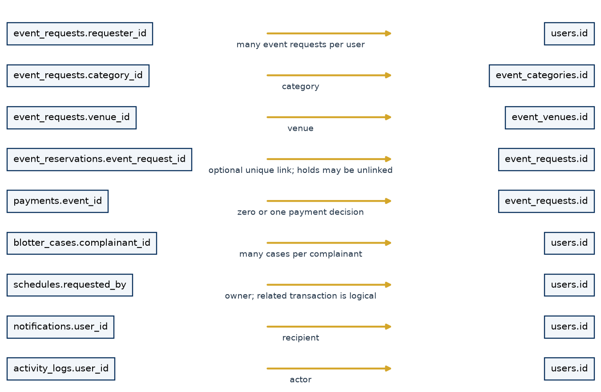

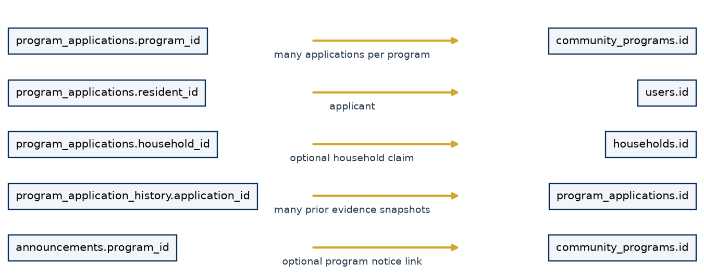

Arrows in these diagrams point from a child foreign-key column toward its referenced parent. They show principal links; repeated actor links are summarized to avoid unreadable diagrams. Polymorphic logical links are discussed in the text and are not drawn as physical foreign-key arrows. The complete column and foreign-key dictionary appears in Appendix A.

## 5.4 Database table catalog

{{TABLE_CATALOG}}

## 5.5 Constraints and integrity

The inspected live schema contains 35 application tables, with no observed SQLite integrity errors or foreign-key violations at the read-only check. This is a point-in-time structural check and does not certify that every operational record is factually correct.

Important constraints include unique usernames/emails and public references; one ResidentProfile per User; unique daily queue numbers; one payment decision per permit/event; exactly one payment target; valid Paid/Waived amounts; one one-time claim key per program; and one feedback response per resident/permit. Program tables also check program kind, status, positive slots and date ordering. Some rules are enforced in routes rather than SQL, including allowed workflow transitions and many text/value choices. SQLite string-length declarations do not by themselves provide the same validation as every form rule.

## 5.6 CRUD with actual examples

| Operation | Simple meaning | Current example |
|---|---|---|
| Create | Store a new row | Add PermitApplication and its ApplicationRequirement snapshots |
| Read | Retrieve stored rows | Show only the current Resident's requests; aggregate Paid amounts |
| Update | Change eligible state/data | Verify evidence or mark a ready permit Completed at release |
| Delete | Remove a row | Revoke a Staff PaymentAuthority row |

Not every module offers all CRUD operations. Announcements use archival instead of deletion; financial decisions have no edit/delete interface. This preserves operational history without claiming the database file cannot be modified by an administrator of the host.

## 5.7 Transactions, commit and rollback

**Simple explanation.** A transaction keeps related changes together. Commit saves the whole successful unit; rollback discards unsuccessful database changes.

**Technical explanation.** The SQLAlchemy session accumulates additions and updates. `flush()` sends pending SQL and supplies generated IDs while leaving the transaction open; it is not the final save. Permit submission flushes the parent, creates snapshots/history/notifications and commits together. If required evidence fails, rollback prevents a half-created request. `services/uploads.py` tracks staged files because database rollback alone cannot remove an already-written file.

Event reservation takes the SQLite writer lock before checking availability and saving the reservation. Payment recording uses unique target keys and catches IntegrityError to reject competing duplicates. Program slot approval acquires a writer lock before counting allocated slots. Queue/release/program, resident-update and ID/address/account decisions use conditional updates against their expected prior state. Several generic status handlers still use ordinary read-then-write checks; concurrency guarantees should not be generalized to every route.

## 5.8 Queries, indexes and persistence

The ORM builds bound-parameter queries for normal user values; migration identifiers come from trusted schema definitions. List pages use filters and pagination. Indexes cover ownership/date lists, approval/status searches, notification owners, references, reservation intervals and program applications. The measured synthetic Permit query used `ix_permit_owner_date`. SQL aggregates (`COUNT`, `SUM`, grouping and date functions) support reports without exporting private case narratives.

Persistent storage must include the SQLite file and private directories. Render's supplied demonstration configuration uses an ephemeral path and therefore cannot guarantee retention across redeploys. SQLite database files are not encrypted by this application; host permissions, persistent storage access and backup protection matter.

## 5.9 Initialization and additive migration

`upgrade_legacy_schema()` creates missing mapped tables, adds known missing columns, creates declared indexes and normalizes selected legacy data. It is designed to be additive and idempotent; it does not drop/rebuild historical tables. It also creates required reference catalogs and compatibility resident profiles. Legacy trusted accounts may be normalized to verified/approved states; this is migration compatibility, not fresh verification evidence.

Adding a column to an old SQLite table does not automatically recreate every model-level CHECK or foreign-key constraint. This document's dictionary separates the actual inspected SQLite foreign keys from ORM declarations. Fresh and upgraded installations should be inspected after migration; schema version history is not managed by Alembic here. Legacy payment flags are not converted into invented payments. Old released/paid records without a linked Payment may require manual reconciliation.

# Chapter 6 — Code and Logic Reference

## 6.1 How to follow a request through the source

Read the matching route in `app.py` or the nested handler registered by `revision_routes.py`; identify its login and permission checks; follow validation/services; find the model columns; then inspect the named template and tests. `permissions.py` defines general grants, while `workflows.py` defines core status transitions. Route-level checks are equally important: payment authority, ownership, designated signing and program processing are not fully described by the general grant table.

The inventory in Appendix B records all 72 source-declared routes with methods, handler and file location. Flask adds its static-file route, producing the 73-route runtime inventory seen in the audit. It is not a public REST API specification: most endpoints return HTML, redirects or document streams.

## 6.2 Important functions/classes

Each entry below states its purpose, input, processing, output, database interaction, authorization context, possible errors and feature. Line references in the generated source index help locate the exact inspected version.

{{FUNCTION_REFERENCE}}

## 6.3 Selected short code examples

The following snippets explain actual code; the full files remain the authoritative implementation.

```python
# services/revision.py: payment_eligible
def payment_eligible(item):
    return payment_status(item) in {"Not Required", "Paid", "Waived"}
```

This central rule lets a free service or authorized waiver progress without inventing a Paid record. Signing, official downloads and release call this rule.

```python
# permissions.py: validate a general grant
def can(role, resource, action):
    grants = ROLE_PERMISSIONS.get(role, {})
    return ("*" in grants or action in grants.get(resource, set())
            or "*" in grants.get(resource, set()))
```

This expresses general role authority. Owner exclusions and financial/signatory checks still belong in the relevant routes.

```python
# Concept expressed by services/event_availability.py
# Two half-open intervals conflict when:
new_start < existing_end and new_end > existing_start
```

This third snippet is an explanatory expression, not an additional project function. Adjacent intervals do not overlap; the real service also checks venue, active state and holds within a serialized transaction.

## 6.4 State transitions and repeated actions

Permit/event/blotter/schedule targets are validated against the acting role and current state. Payment unique keys and program claim keys enforce single records in the database. Queue/release/program, requirement review and verification/account conditional updates reject stale page decisions. For account approval, the SQL condition also requires both verification states still to be Verified. The newer stabilization suite exercises simultaneous account approvals and observes one approval log and one three-channel notification set. This is evidence for that tested race, not every possible concurrent action.

## 6.5 Compatibility names and inactive fields

`submission_receipt()` is a legacy internal name for the Submission Acknowledgment DOCX endpoint. `walkin_claim_stub()`/`claim-stub.docx` generate the renamed walk-in acknowledgment. `/announcements/<id>/delete` archives the row. Event attendee/attachment columns remain for historical data but are not current input features. Model existence alone does not prove a complete UI workflow: queue priority, referral assignment, blotter resolution and schedule notes must be assessed against routes/templates.

# Chapter 7 — Security and Privacy

## 7.1 Implemented controls

**Simple explanation.** Security checks who is signed in, what role they have, which record they own, and whether the action is valid now.

**Technical explanation.** Passwords are stored using Werkzeug hashes, not plaintext. Flask's signed session cookie identifies the account. HttpOnly and SameSite=Lax are configured; Secure depends on `SESSION_COOKIE_SECURE` and is enabled in the supplied Render configuration. The default development secret must be replaced outside local development. Protected routes recheck user activity/approval rather than trusting only hidden buttons.

CSRF tokens are random session values checked with constant-time comparison on POST/PUT/PATCH/DELETE using a form field or header. SQLAlchemy binds ordinary query values. Jinja's normal HTML escaping protects ordinary rendered variables; developers must preserve escaping and avoid introducing unsafe HTML/JavaScript sinks. These controls reduce specific risks; the system has not undergone a complete penetration test and does not implement every possible security defense.

Uploads accept PDF, PNG and JPEG extensions with matching file signatures and use opaque random filenames. The total request size is limited to 8 MiB, which includes multipart/form overhead rather than allowing 8 MiB for every file. Private paths are outside `static`; serving routes use basename resolution, existence checks and authorization. Signature uploads accept PNG/JPEG only. File signature checks are not malware scans or full document parsers.

Reset tokens are random, hashed, expiring and marked used; the production delivery channel is absent. Staff self-processing guards apply to transaction review and release. Program processing/payment recording prohibit the owner regardless of operational role. General assignment does not create a new permission grant.

## 7.2 Privacy access boundaries

| Data | Current access boundary | Documentation caution |
|---|---|---|
| Valid ID upload/number | Owner or Administrator document access; masked number in relevant views | No government verification API; ID changes restart review |
| Address/emergency/profile details | Own Profile; authorized operational/admin views | Do not export real profiles into documentation/screenshots |
| Permit/event/blotter records | Resident owner; Staff/Admin operational access | Assignment is not exclusive case access |
| Permit requirement files | Non-owner Staff processor or Administrator | Not a general Resident evidence download endpoint |
| Program application evidence | Owner or Staff/Admin; owner barred from processing | Aggregates exclude evidence and applicant narratives |
| Payment receipt | Owner or financially authorized personnel | Ordinary Staff financial access is limited |
| Household/concern/referral | Staff/Admin front desk | Sensitivity labels are not separate Staff clearance enforcement |
| Signature images | Private storage; configured Admin applies signature | Downloaded signed DOCX contains an image; not a cryptographic seal |
| Reports/logs | Administrator | Logs may contain operational details/IP; protect exported files |

## 7.3 Security and privacy limits

No database encryption, malware scanner, multi-factor login, comprehensive rate limiting, tamper-evident audit chain, retention/deletion schedule or external identity validation is implemented in the inspected source. This list describes the implementation, not a legal compliance assessment. Access by a host/database administrator remains outside the web application's permission boundary. Real deployment requires protected secrets, HTTPS, storage permissions, controlled backups and an approved operational policy.

## 7.4 Error handling

| Condition/status | Actual behavior |
|---|---|
| Invalid login | Shows validation/authentication feedback without establishing an authorized session |
| Unauthenticated protected page | Login redirect; 401 handler also redirects to login |
| 400 | Invalid CSRF, malformed values or invalid transitions produce the configured bad-request response |
| 403 | Permission/ownership denial uses the configured forbidden response |
| 404 | Missing route/record uses the not-found response; some legacy document handlers redirect with a flash instead |
| 405 | Unsupported method uses the workflow error template |
| 409 | Duplicate/conflicting payment, release or program state uses conflict feedback |
| 413 | Oversized upload request uses the workflow error template |
| 422 | Registered workflow error response, when raised |
| 500 | Rolls back the session and renders the generic server-error page |
| Invalid upload/value | Common form handlers roll back and flash feedback or abort with 400 |
| Expired reset token | Redirects to Forgot Password with an invalid/expired message |

The application does not automatically retry every failed transaction. Operators should reload and inspect current state before repeating a financial or release decision. Error feedback should not be treated as proof that an external physical action did not occur.

# Chapter 8 — Reports and Analytics

## 8.1 Real-data reporting pipeline

**Simple explanation.** Reports count and summarize records already stored in SQLite. They do not invent sample values when no records exist.

**Technical explanation.** `validate_filters()` accepts report type and applicable date/year/month/status/source/service/Purok/program/category selections. `build_report()` executes scoped ORM aggregates and returns named sections containing real category/value rows. Browser Canvas charts and tables share these rows. `chart_png()` uses matplotlib for printable charts. `word_report()` writes native Word headings, paragraphs and tables plus chart images and source tables. `reports()`, `report_export()` and chart endpoints require Administrator permissions and audit relevant report actions.

## 8.2 Implemented reporting areas

| Report | Main data and interpretation |
|---|---|
| Overall Barangay | Combined supported module summaries |
| Residents | Registered/active approved profiles, residency/type/Purok distributions and registration trend |
| Households | Status counts and active-member household-size distribution |
| Permits | Status/service/source, approval/rejection/resubmission proportions, released count and measured duration |
| Events | Type/status/venue, submission trend, reserved hours and logged conflicts |
| Blotters | Case status and creation trend; no private narratives |
| General Concerns | Category/status and trend |
| Walk-in Transactions | Permit transactions whose source is not Online |
| Queue | Status/volume, recorded wait/serve duration where timestamps exist |
| Appointments | Schedule status and creation trend |
| Payments | Positive Paid collections, payment-time trend, service/event sums, waiver composition and unpaid requests |
| Scholarship | Program/application counts, states, claim rules and completed allocations |
| Ayuda | Same reusable reporting engine restricted to Ayuda |
| Announcements | Lifecycle/category and creation trend |
| Feedback | Response count, rating distribution and mean if ratings exist |
| Staff Operations | Recorded Staff actions and assisted transaction counts, not productivity rankings |
| Activity/Audit Summary | Action and actor-role counts |

Date filters normally apply to record creation. Payments use `paid_at`; unpaid counts explicitly use the submission period. Queue/date interpretation follows stored timestamps. Report time buckets use SQLite date functions with a +8-hour adjustment for stored UTC. Status filters represent current state, including on monthly composition charts; they are not a complete historical state-at-month-end reconstruction. Months without rows are not synthesized as observed transactions. Empty aggregates display no records rather than fake charts.

## 8.3 Visualization choices

Summary cards show compact totals. Lines show month-grouped trends; bars compare categories; donuts show composition for small category sets; stacked bars compare month/status composition; editable tables preserve exact values. Donuts with too many categories fall back to bars. A separate area-chart implementation is not present. The chart is an aid to reading counts, not a statistical forecast or causal analysis.

## 8.4 Word export and privacy

Administrator POST `/reports/export/docx` validates filters again, builds the report, creates a `reports` metadata row and records export actions. The DOCX includes the title, generating user/time, selected filters, summary, sections, charts and native editable tables. Chart pictures are not editable chart objects, but adjacent source tables remain editable. Resident ID images, private program evidence and blotter narratives are excluded from aggregates. The Staff Operations report can identify Staff by name; it is restricted administrative output.

All 17 report types produced structurally valid editable DOCX files in the test evidence. Opening the files in installed Microsoft Word was not verified. Application `/reports/export/pdf` is not implemented; this capstone PDF is a separate documentation deliverable.

# Chapter 9 — Testing and Quality Assurance

## 9.1 Evidence and methodology

Testing evidence comes from `tests/test_system.py`, `test_revision.py`, `test_stabilization.py`, `validate_sqlite.py`, `browser_audit.py`, `audit_inventory.py` and saved audit artifacts. This documentation does not turn source inspection into a fabricated runtime Pass. {{LATEST_TEST_RESULT}} The earlier October 5 audit recorded 35 passing tests; the latest run includes the newer stabilization cases. Exact captured output is retained in `documentation/acceptance-run.txt`.

Tests use isolated fixtures for account/role behavior, permits, requirement snapshots, payments, event reservations, programs, announcements, documents and database integrity. Concurrent tests exercise specific pairs of competing submissions. Browser tests used Edge at widths 1440, 1024, 768 and 390 with synthetic Administrator/Staff/Resident users. The saved result contains 160 page checks, zero captured JavaScript errors and zero horizontal-overflow detections. This is not a complete device/accessibility laboratory or load test.

## 9.2 Test cases and actual results

{{TEST_CASES}}

## 9.3 Performance observations

The isolated benchmark seeded 5,000 synthetic permit records. Post-change medians were 16.82 ms for Dashboard, 9.37 ms for front-desk search, 12.83 ms for Permit list, 3.32 ms for Event list, 3.58 ms for Activity Logs, 3.58 ms for Notifications, and 24.48 ms for Permit analytics. The measured Word export took 1,495.51 ms and returned 116,901 bytes. No comparable pre-change measurements exist, so no percentage improvement is claimed.

Pagination bounds many lists at 30 rows; announcements/program lists use their own 20/25-row sizes. Front-desk search is limited to 50. Query indexes support common owner/date filters. Some front-desk queues/ready lists and schedule choices still load all matching records. Reports execute several aggregate queries, and overall DOCX generation can be expensive. Busy buttons prevent ordinary repeated browser submissions, but database constraints and conditional writes remain necessary for concurrent requests.

## 9.4 Failed, partial and untested areas

The automated suite passed within its scenarios; warnings include datetime/SQLAlchemy deprecations and file-handle cleanup warnings. Real SMS/email delivery, physical printing, installed Microsoft Word rendering, production-scale multi-client load, a full penetration test and manual assistive-technology testing were not performed. There is no application PDF export to test. Structural validation of this documentation PDF is separate from application functionality.

Source inspection for documentation identified partial behaviors not covered by the earlier overall “stable within tested scope” statement: the pre-approval correction gap, appointment Rescheduled without time editing, unenforced queue priority, partial concern/referral and blotter completion forms, and broad operational access despite sensitivity labels. The current working tree also contains newer verification reset/conditional-update fixes, which this document incorporates. These distinctions prevent the earlier audit summary becoming a blanket assurance.

# Chapter 10 — User Manuals

## 10.1 Resident manual

1. Open Register. Complete account, personal, residence and emergency-contact fields. Choose an active accepted ID type, upload supported evidence and provide privacy consent. Submit once.
2. Wait for Administrator verification and approval. Pending/rejected accounts cannot use normal service pages. If correction is required before approval, contact the office; a complete unauthenticated correction portal is not implemented.
3. Log in after approval. Check the Dashboard, Announcements and Notifications. Use Manage Profile to change permitted information or your password. ID changes restart ID review; street/Purok changes restart address review.
4. Open My Permits, select an available service and review its configured fee/requirements. Enter purpose and all required evidence. Save the Submission Acknowledgment and reference.
5. Open the request detail to track evidence and processing states. If an item is Needs Resubmission, read the reason and use its replacement input. Resubmit the correct file/text; do not assume replacing one item approves the whole request.
6. After final approval, follow the office's payment instructions if a positive fee applies. Only authorized personnel record payment. Use Payments to view your state and download a receipt only when a Paid record exists.
7. When the permit is signed and Ready for Pickup, download the approved DOCX and follow release instructions. At the counter, personnel confirm identity and record release. Downloading alone does not record counter release.
8. Open My Event Requests, choose category/venue, enter event details and a valid date/time interval. If a conflict is shown, accept the held recommendation before expiry or decline and choose another date. Keep the acknowledgment.
9. Open My Blotter Reports and enter respondent, incident and narrative details accurately. Track the case state; the software does not provide legal advice or automatically schedule a hearing from a state label.
10. Open My Schedules and choose one of your existing transactions. Request a date/time and purpose, then monitor its state. Residents do not confirm/cancel schedules through operational status controls.
11. Read Notifications and mark messages read. Email/SMS labels describe simulated records in this version.
12. Open Community Programs, read eligibility/dates/instructions and submit required evidence. One-time Resident/Household claim rules apply. Follow Needs Requirements feedback and monitor review/completion.
13. After your permit is Completed, submit one 1–5 feedback rating and an optional comment. Repeated ratings for the same permit are rejected.

## 10.2 Barangay Staff manual

1. Log in using your assigned active account. Review operational summaries and use Resident Services for assisted work.
2. Search a resident by name, numeric ID, contact, household or Purok. Confirm the correct person before selecting Assist this Resident. Search cards are not independent identity proof.
3. Select a configured permit service, enter purpose/counter and capture all required evidence. Submit to create the normal permit record and a queue ticket. Print/download the Walk-in Transaction Acknowledgment.
4. Progress the ticket through Now Serving, Start Service and Complete Service. Queue completion is separate from permit approval/release. Apply any locally approved priority policy manually because no automatic priority engine is present.
5. Open a permit not owned by you. Inspect required files/text and set appropriate review states. Give a specific correction reason when returning evidence. Endorse only after all required items are verified.
6. Review/endorse eligible event requests and progress blotter states within your permissions. Final permit/event approval is Administrator work. An event schedule conflict is resolved through the reservation flow, not by changing an unrelated appointment.
7. Create/confirm/complete transaction-linked appointments as permitted. The Rescheduled control currently changes status only; coordinate the actual correction with the Administrator rather than assuming it edits time.
8. Assign permits to an eligible colleague and add a useful note. Assignment does not permit a colleague to process their own request or gain Admin authority.
9. At release, inspect the ready permit, confirm the resident's identity and record release. The backend also checks signature and payment. Do not release your own request.
10. Record general concerns and route them; submit proposed profile changes; create/transfer household membership; record referrals. Recognize that concern/referral resolution and move-out workflows are incomplete.
11. Draft Scholarship/Ayuda programs or announcements, assist approved applicants, review evidence and qualify applications. Administrator approval/publication/completion controls remain separate.
12. Record manual payments only after explicit Administrator authorization. You cannot waive fees or record your own payment. Ordinary Staff accounts show their own financial transactions only.
13. Submit personal Resident requests using your account, then let another authorized person process them. No second account is required merely to separate personal requests from duties.

## 10.3 Administrator manual

1. Review Dashboard totals and pending decisions. Open User Management to inspect registration details and private ID evidence.
2. Verify or reject each Pending ID/address review. Supply a correction reason when rejecting. Approve the Pending account only after both verifications are Verified. Sequential repeat decisions are rejected.
3. Manage account roles/activity carefully; preserve an active Administrator. Configure active Resident Types and accepted ID types according to approved office policy.
4. In Configuration, create/update Permit Types, Event Categories and Venues. Explicitly configure each service fee, including zero for free services. Unconfigured pricing makes new service submission unavailable.
5. Add Document/Text/System Check requirements with required/optional flags and order. Changes apply to new applications; historical snapshots remain attached to older applications.
6. Configure each permit's protected signature image, name/title and authorized Administrator. Complete final review after endorsement. For paid services, record payment or a justified waiver before signing.
7. In Payments, grant/revoke Staff authority as needed. Record only verified physical cash collection at the exact fee snapshot. Use a waiver only with a reason. Download a receipt only for an actual Paid record.
8. Apply the signature as the designated Administrator, then allow release through the counter. Approval, signing and release are distinct actions.
9. Review Staff program drafts, confirm eligibility/requirements/deadlines/claim rule/slots and publish. Review Qualified applications, approve/waitlist within capacity, and confirm assistance release or scholarship completion when it actually occurs.
10. Approve announcement drafts with valid future expiry. Use start/expiry times in Asia/Manila. Archive obsolete notices; expired history is retained.
11. Use Reports & Analytics to choose one of 17 report types and only applicable filters. Read exact tables alongside charts. Export DOCX; protect the downloaded administrative report.
12. Use Activity Logs to trace recorded actions. Logs support accountability but are not a comprehensive, tamper-proof record of every database operation.
13. Review proposed resident updates and household consistency. Approved address/Purok edits restart address verification; inspect the new information before verifying it again.

# Chapter 11 — Deployment, Maintenance and Backup

## 11.1 Environment and dependencies

The local verification environment uses Python 3.14. The supplied Render configuration specifies Python 3.13.15; source uses `datetime.UTC`, so older runtimes must be assessed before use. Exact application dependencies are pinned in `barangay_system/requirements.txt`. Gunicorn is for the supplied Linux deployment; `run.ps1` uses Flask's development server for local work. The initial supported-ID catalog is not automatically accepted for registration: the Administrator must activate acceptance according to local policy.

From the project root on Windows:

```powershell
.\setup.ps1
# Initialize catalogs/schema, and create the first Administrator
# only after securely supplying INITIAL_ADMIN_* variables.
cd barangay_system
..\.venv\Scripts\python.exe seed.py
cd ..
.\run.ps1
```

Before first `seed.py`, set `INITIAL_ADMIN_USERNAME`, `INITIAL_ADMIN_EMAIL`, `INITIAL_ADMIN_NAME` and a privately chosen `INITIAL_ADMIN_PASSWORD` through your deployment environment. This documentation deliberately provides no reusable password. The seeder preserves an existing Administrator and creates missing base permit/event catalogs; it does not create demonstration Staff/Resident accounts. New service prices are not automatically approved merely by seeding. `flask --app app init-db` is available for additive schema initialization; `create-admin` is also exposed as a CLI command in `app.py`.

## 11.2 Configuration reference

| Variable/setting | Purpose | Operational note |
|---|---|---|
| SECRET_KEY | Signs sessions | Set a strong private value; do not use development fallback |
| DATA_DIR | Base persistent runtime directory | Contains private files and default database |
| SQLITE_DB_PATH | SQLite file path | Relative paths resolve against the application directory |
| DATABASE_URL | Optional SQLite connection override | Non-SQLite URL rejected; coordinate with backup path |
| SESSION_COOKIE_SECURE | HTTPS-only session cookie | Enable under HTTPS |
| FLASK_DEBUG | Development debug mode | Disable for public deployment |
| SMS_PROVIDER | Configuration placeholder | Does not install or activate an actual SMS integration |
| BARANGAY_NAME / CITY_MUNICIPALITY | Configured naming values | Some document calls also contain fixed project labels |
| INITIAL_ADMIN_* | Initial account provisioning | Needed when no Admin exists; keep password private |
| RESET_TOKEN_MINUTES | App-config default: 30 | Set in app configuration; not automatically an environment parser |

Keep `DATABASE_URL` and `SQLITE_DB_PATH` consistent: the runtime may use the former while `backup_sqlite.py` reads the latter. The backup utility does not automatically derive its source from an overridden SQLAlchemy URL.

## 11.3 Deployment boundary

`render.yaml` starts `python seed.py` then Gunicorn with one worker, four threads and a 120-second timeout, and uses `/healthz`. Its configured `/tmp/minante-data` path is demonstration storage; the project deployment notes identify the ephemeral-storage limitation. A real persistent installation needs a persistent volume, one service instance, protected secrets and controlled upgrades. This documentation does not claim a successful production deployment or inspect the remote GitHub repository.

## 11.4 SQLite backup and recovery

**Simple explanation.** A usable backup includes both the transaction database and the documents it refers to. Restoring only the database can leave missing IDs/evidence/signatures.

**Technical explanation.** From the application directory, run `..\.venv\Scripts\python.exe backup_sqlite.py` with the same configuration as the service. The utility opens the configured SQLite file, uses sqlite3's backup API to a timestamped `.partial` file, runs `PRAGMA integrity_check`, then renames the verified file into `DATA_DIR/backups`. This is safer for a live WAL database than copying only the main database file during writes.

For a coordinated recovery point, pause application writes, create the database backup, and copy the matching private uploads, identifications, signatures and relevant generated files into controlled backup storage. Record configuration and software version without publishing secrets. Resume only after the backup set is confirmed. The provided utility backs up the database, not the private directories or an off-host archive.

To restore, stop the service, preserve the current data set as a rollback copy, restore a chosen database/private-file set into a separate test location, check integrity and representative document access, then switch the configured paths and restart one service instance. Verify account access, key record counts and authorized document downloads before reopening use. Do not overwrite a live database with active WAL writers. Backup restoration drills and retention/encryption schedules are recommended operational procedures, not automated features claimed in code.

## 11.5 Maintenance and handover

1. Record the current source version and back up before schema upgrades.
2. Run additive initialization, then appropriate acceptance tests on an isolated copy.
3. Review application errors, operational logs, disk space and failed/simulated notification states.
4. Add new Permit Types and requirements through Configuration; explicitly set fees and signatory authority before offering them.
5. Explain to personnel that fee/requirement changes affect new submissions, not old snapshots.
6. Create programs with clear dates/claim rules and publish only after review. Check expired announcements in history rather than deleting records.
7. Update pinned dependencies deliberately and retest affected behavior; current deprecation/resource warnings deserve maintenance attention.
8. Reconcile private-file storage, household membership and historical financial flags where needed. Do not fabricate missing financial history.

## 11.6 GitHub and documentation maintenance

The intended repository is `tagalfranz23/My-projects-`. This package is based on the available local working tree, not a remotely verified commit. Git was unavailable during the preceding audit; tracked-file status and remote contents were not certified.

Root/application ignore rules cover `.env`, databases/WAL files, runtime uploads, private IDs/signatures, backups, Python caches and generated audit artifacts. Ignore rules do not remove files already committed. Before publishing, the maintainer must inspect the actual staged diff and tracked files. Documentation must never contain real resident rows, ID images, credentials, private program documents or live signature assets.

`documentation/CAPSTONE_DOCUMENTATION.md` is the current narrative source; `source_evidence.json` captures code/schema metadata without operational rows. `build_documentation.py` generates the editable DOCX, PDF, cheat sheet and validation summary. `documentation/requirements.txt` keeps PDF build tools separate from application runtime requirements. Historical research files are retained and are not authoritative for current behavior.

# Chapter 12 — Strengths, Limitations and Future Work

## 12.1 Verified strengths

The source provides centralized related records; clear Resident/Staff/Admin responsibilities; server-side ownership controls; fee/requirement snapshots; a common online/assisted permit workflow; tested reservation/payment/claim constraints; private upload paths; reusable community programs; time-bounded announcement feeds; and real aggregate reporting with editable Word output. These are design and implementation strengths, not claims of perfect usability or measured community impact.

## 12.2 Current limitations and weak areas

| Area | Current limitation | Practical implication |
|---|---|---|
| Notifications/recovery | No live email/SMS transport | Production password recovery delivery and external reminders need integration |
| Verification | Address/ID reset is implemented, but a pending/rejected correction portal is incomplete | Reset requests human review; it is not automatic verification |
| Concurrency | Conditional/unique protection is not used uniformly | Sequential guards do not prove all competing decisions execute once |
| Scheduling/time | Rescheduled does not edit time; older event/schedule naive times differ from explicit Manila conversion | Appointment/timezone behavior needs focused work |
| Priority/assignment | Stored priority is not applied; office/officer scheduling is incomplete | Operational policy remains manual |
| Blotter/concern/referral | Several stored fields and closing workflows lack complete forms | State/intake support is narrower than full case management |
| Household data | Direct profile text can diverge from actual memberships | Use verified membership rows for household claims |
| Walk-in eligibility | Helper does not universally enforce approved active profile | Personnel must verify assisted-client eligibility |
| Financial scope | Cash exact amount/waiver only; no refund or reconciliation workflow | Not a complete accounting/payment-gateway system |
| Signatures | Editable document with signature image | No certificate-based integrity/nonrepudiation guarantee |
| Storage | Local private files; unencrypted SQLite; backup utility is database-only | Host security and coordinated file backups are necessary |
| Scale | One SQLite writer; several unbounded operational lists | Real-load testing required before expanding use |
| Audit/privacy | Explicit logs only; sensitivity labels do not add fine-grained Staff clearance | No universal change capture or case-assignment privacy guarantee |
| Testing | Synthetic scenarios, no installed Word/printer/provider verification | Do not present automated Pass as all-environment certification |

## 12.3 Future enhancements — not current features

Future work should first complete pre-approval correction, appointment time edits and timezone consistency, case/referral completion forms, household move-out reconciliation, eligibility checks and conditional state updates where missing. Separate, later enhancements may include approved SMS/email transport, payment reconciliation or a gateway, cryptographic document signing, malware scanning, encrypted off-host backups and restore automation, multi-factor/rate-limit protections, fine-grained case access and broader accessibility/load testing. A mobile client or different database should follow demonstrated needs rather than being described as already implemented.

# Chapter 13 — Capstone Defense Reviewer

The following questions and answers refer to this inspected implementation. They are preparation material, not a record of questions actually asked by a defense panel.

{{DEFENSE_QUESTIONS}}

# Glossary

{{GLOSSARY}}

# Appendix A — Complete SQLite Data Dictionary

The following tables come from a read-only inspection of the local SQLite schema. All actual columns, declared types, primary keys, defaults, foreign keys and indexes are listed. No operational row values are included. SQLite primary keys are treated as identifying fields even where `PRAGMA table_info` reports the not-null flag as zero. Nullability and DDL are storage facts, not a replacement for route validation.

{{DATA_DICTIONARY}}

# Appendix B — Route Inventory

This is the full source-declared route inventory; methods shown omit Flask's automatic HEAD/OPTIONS handling. Access summaries combine declared decorators with route checks; Chapter 2 and Chapter 4 explain workflow-specific restrictions. Source locations identify the inspected handler. Paths are internal route patterns, not links to an exposed production service.

{{ROUTE_INVENTORY}}

# Appendix C — Source Evidence and Reproduction

Source references in this document point to the local project files. No external papers or survey references are invented. The companion `source_evidence.json` records paths, line counts, SHA-256 source fingerprints, symbols, routes, tests and schema metadata. The source review began October 5, 2026; document completion is October 7, 2026 (Asia/Manila). The older browser/performance evidence and current captured acceptance run are distinguished.

{{SOURCE_INDEX}}

# Appendix D — Final Documentation Verification

- Final source modules, route registrations, workflows, templates, static files, configuration, schema, migrations and audit evidence were inspected.
- SQLite is documented as the current database; old MariaDB material is classified as historical.
- All three roles, implemented modules and direct/route-specific permission boundaries are covered.
- Registration, ID/address verification, dynamic requirements, permits, events, blotters, walk-in, queues, payments, households, programs and announcement expiry are covered, including partial behavior.
- Reports, analytics, DOCX, audit logs, security, database fields, ERDs, code examples and actual test evidence are included.
- Resident, Staff and Administrator manuals, maintenance/backup instructions, glossary and at least 75 defense questions are included.
- The separate condensed cheat sheet covers purpose, roles, workflows, technologies, database, controls and limits in three pages.
- Screenshots use synthetic test fixtures. Operational rows, private ID files, signatures, passwords and secrets are excluded.
- Editable Word text/tables and PDF structure are checked by the documentation validation script; actual Microsoft Word application rendering and physical print quality remain unverified.
